# Medical LLM: End-to-End System Architecture & Step-by-Step Pipeline Walkthrough

A comprehensive technical guide to the **Medical LLM** repository—from raw MIMIC-III Electronic Health Record (EHR) ingestion (Step 0) through data leakage prevention, multimodal Transformer modeling, leak-free 5-fold cross-validation, and the Semantic Communication & Explanation Validation system.

---

## 1. Executive Summary & Clinical Task

The clinical objective of this repository is **in-hospital mortality prediction** using temporal Intensive Care Unit (ICU) data from the MIMIC-III clinical database. The system models both:

1. **Multivariate Temporal Time-Series**: Longitudinal laboratory measurements, time intervals, and patient demographic profiles.
2. **Unstructured Clinical Notes**: Semi-structured admission and triage notes processed via clinical NLP (`Bio_ClinicalBERT`).
3. **Semantic Communication**: An explainable clinical communication layer that converts technical model activations and decile distributions into clinician-readable risk narratives with an automated hallucination auditor.

---

## 2. High-Level Pipeline Architecture

```mermaid
flowchart TD
    subgraph Step0["Step 0: Raw Data & Ingestion"]
        A1["ADMISSIONS.csv"]
        A2["PATIENTS.csv"]
        A3["LABEVENTS.csv"]
        A4["D_LABITEMS.csv"]
        A5["structured_medical_records.csv"]
    end

    subgraph Step1["Step 1: Patient Alignment & Temporal Boundaries"]
        B1["Inner Join Admissions + Patients"]
        B2["Age Derivation (Capped at 90)"]
        B3["Target: hospital_expire_flag"]
        B4["Cutoff Time: min(dischtime, deathtime)"]
    end

    subgraph Step2["Step 2: Leakage Shields"]
        C1["Temporal Filter: (admittime-24h <= t <= cutoff)"]
        C2["Identifier Stripper: clean_text()"]
        C3["Patient-Level Stratified Group Splitting"]
        C4["Fit Quantile Deciles ONLY on Train Split"]
    end

    subgraph Step3["Step 3: Temporal Tokenization"]
        D1["Discretize Labs: LAB_itemid_Qx"]
        D2["Delta Time Bins: TIME_LT1H, TIME_1TO6H, etc."]
        D3["Demographics: AGE_x, GENDER_x, ADM_x"]
        D4["Token Sequence Assembly -> sequence_dataset.json"]
    end

    subgraph Step4["Step 4: PyTorch DataLoaders & Multi-Modal Dataset"]
        E1["Train-Only Vocab Construction"]
        E2["MedicalDataset / MultiModalMedicalDataset"]
        E3["Token Padding & Mask Generation"]
    end

    subgraph Step5["Step 5: Model Architectures"]
        F1["Pre-LN MedicalTransformer (Time-Series)"]
        F2["Bio_ClinicalBERT (Clinical Notes Backbone)"]
        F3["GatedCrossModalFusion (Dynamic α Gating)"]
    end

    subgraph Step6["Step 6: Training & 5-Fold Stratified CV"]
        G1["StratifiedGroupKFold (Zero Patient Leakage)"]
        G2["Weighted BCE Loss: pos_weight = N_neg / N_pos"]
        G3["Cosine Annealing LR + Early Stopping"]
    end

    subgraph Step7["Step 7: Semantic Communication & Auditing"]
        H1["ClinicalDictionary Concept Mapping"]
        H2["SemanticTransformerEncoder -> SemanticRepresentation"]
        H3["SemanticTransformerDecoder -> Clinical Narrative"]
        H4["ExplanationValidator (Hallucination Audit)"]
    end

    Step0 --> Step1
    Step1 --> Step2
    Step2 --> Step3
    Step3 --> Step4
    Step4 --> Step5
    Step5 --> Step6
    Step6 --> Step7
```



---

## 3. Step-by-Step Deep Dive (Step 0 to Step 8)

### Step 0: Raw Medical Data Ingestion & Schema Alignment

The repository ingests five raw relational tables originating from MIMIC-III (or generated by [generate_dummy_data.py](file:///c:/PVR/Coding/medical_llm/generate_dummy_data.py) for testing):

1. **[ADMISSIONS.csv](file:///c:/PVR/Coding/medical_llm/ADMISSIONS.csv)**: Contains admission metadata (`subject_id`, `hadm_id`, `admittime`, `dischtime`, `deathtime`, `admission_type`, `hospital_expire_flag`).
2. **[PATIENTS.csv](file:///c:/PVR/Coding/medical_llm/PATIENTS.csv)**: Contains demographic background (`subject_id`, `gender`, `dob`, `dod`, `expire_flag`).
3. **[LABEVENTS.csv](file:///c:/PVR/Coding/medical_llm/LABEVENTS.csv)**: Longitudinal timestamped lab draws (`hadm_id`, `itemid`, `charttime`, `valuenum`, `flag`).
4. **[D_LABITEMS.csv](file:///c:/PVR/Coding/medical_llm/D_LABITEMS.csv)**: Dictionary mapping `itemid` integers to human-readable lab labels (e.g., Creatinine, Potassium, Lactate).
5. **[structured_medical_records.csv](file:///c:/PVR/Coding/medical_llm/structured_medical_records.csv)**: Free-text medical notes and physician discharge/admission reports linked by `hadm_id`.

**Implementation Reference:** [load_raw_tables() in src/medical_llm/data/preprocessing.py](file:///c:/PVR/Coding/medical_llm/src/medical_llm/data/preprocessing.py#L104-L145).

---

### Step 1: Patient Alignment, Age Derivation & Target Definition

In [process_admissions_and_patients()](file:///c:/PVR/Coding/medical_llm/src/medical_llm/data/preprocessing.py#L21-L54):

1. **Inner Join**: Joins `ADMISSIONS` and `PATIENTS` on `subject_id`.
2. **Temporal Prediction Cutoff**:
   $$
   \text{cutoff\_time} = \begin{cases} \min(\text{dischtime}, \text{deathtime}) & \text{if } \text{deathtime is not null} \\ \text{dischtime} & \text{otherwise} \end{cases}
   $$

   *Why this matters*: Any observation recorded *after* this cutoff represents post-outcome data leakage.
3. **MIMIC-III Date-of-Birth Handling**:
   In MIMIC-III, patients over 89 years old have their birthdates shifted into the distant past (over 300 years) to protect HIPAA de-identification. A direct timestamp difference triggers 64-bit nanosecond integer overflow. The pipeline computes age using calendar year components:
   $$
   \text{age} = \text{year}(\text{admittime}) - \text{year}(\text{dob}) - \mathbb{I}(\text{admittime}_{\text{month,day}} < \text{dob}_{\text{month,day}})
   $$

   Ages strictly $> 89$ are capped at 90.
4. **Binary Target**:
   $$
   \text{target} = \text{hospital\_expire\_flag} \in \{0, 1\}
   $$

---

### Step 2: The Multi-Layer Data Leakage Shield

Medical predictive AI is exceptionally vulnerable to data leakage. This codebase implements four distinct leakage defenses:

| Leakage Type                         | Threat Scenario                                                                                          | Mitigation Strategy                                                                                                                                                                                          | Implemented In                                                                                                                                                                                                             |
| :----------------------------------- | :------------------------------------------------------------------------------------------------------- | :----------------------------------------------------------------------------------------------------------------------------------------------------------------------------------------------------------- | :------------------------------------------------------------------------------------------------------------------------------------------------------------------------------------------------------------------------- |
| **Patient Leakage**            | Same patient appears in both Train and Test folds across different hospital stays.                       | `StratifiedGroupKFold` & `GroupShuffleSplit` grouped strictly by `subject_id`. All hospitalizations of a single patient remain in the same split.                                                      | [cross_validator.py:L507-L548](file:///c:/PVR/Coding/medical_llm/src/medical_llm/pipeline/cross_validator.py#L507-L548), [dataset.py:L125-L193](file:///c:/PVR/Coding/medical_llm/src/medical_llm/data/dataset.py#L125-L193) |
| **Quantile Leakage**           | Lab value decile cutoffs calculated on the entire cohort, leaking test distributions into preprocessing. | Quantile boundaries calculated**strictly** on the training split lab events (`fit_quantiles()`), saved to disk, and applied statically (`apply_quantiles_to_labevents()`) to validation/test sets. | [quantiles.py:L11-L72](file:///c:/PVR/Coding/medical_llm/src/medical_llm/utils/quantiles.py#L11-L72), [preprocessing.py:L147-L197](file:///c:/PVR/Coding/medical_llm/src/medical_llm/data/preprocessing.py#L147-L197)        |
| **Temporal Lookahead Leakage** | Laboratory tests or notes recorded after death or discharge inform the mortality classifier.             | Hard filter retaining only measurements satisfying:`admittime - 24h <= charttime <= cutoff_time`.                                                                                                          | [preprocessing.py:L83-L88](file:///c:/PVR/Coding/medical_llm/src/medical_llm/data/preprocessing.py#L83-L88), [preprocessing.py:L133-L141](file:///c:/PVR/Coding/medical_llm/src/medical_llm/data/preprocessing.py#L133-L141) |
| **Identifier Leakage**         | Explicit IDs or calendar dates in notes allow the model to memorize patients or temporal shortcuts.      | Regex-based sanitization stripping`Patient ID`, `Admission ID`, exact calendar years/dates, and timestamps while preserving medical findings and negation.                                               | [text_utils.py:L10-L35](file:///c:/PVR/Coding/medical_llm/src/medical_llm/data/text_utils.py#L10-L35)                                                                                                                       |

---

### Step 3: Quantization & Temporal Sequence Construction

Continuous laboratory numbers are discretized to build medical token sequences:

1. **Continuous Lab Discretization**:
   Continuous lab measurements $v \in \mathbb{R}$ for item $i$ are mapped into 10 deciles ($Q0$ through $Q9$) using training-derived boundaries:

   $$
   \text{token} = \begin{cases} \text{LAB\_}\{itemid\}\text{\_Q}\{q\} & \text{if quantile fitted} \\ \text{LAB\_}\{itemid\}\text{\_}\{\text{FLAG}\} & \text{if fallback} \end{cases}
   $$
2. **Irregular Temporal Gap Modeling**:
   ICU lab draws occur at irregular intervals. Elapsed time $\Delta t$ between consecutive observations is discretized into relative time-gap tokens:

   - $\Delta t < 1\text{h} \rightarrow \text{TIME\_LT1H}$
   - $1\text{h} \le \Delta t < 6\text{h} \rightarrow \text{TIME\_1TO6H}$
   - $6\text{h} \le \Delta t < 24\text{h} \rightarrow \text{TIME\_6TO24H}$
   - $24\text{h} \le \Delta t < 72\text{h} \rightarrow \text{TIME\_1TO3D}$
   - $\Delta t \ge 72\text{h} \rightarrow \text{TIME\_GT3D}$
3. **Composite Sequence Token Formatting**:

   ```
   [CLS] AGE_70 GENDER_M ADM_EMERGENCY [SEP] LAB_50813_Q9 TIME_LT1H LAB_50912_Q9 TIME_1TO6H ... [REPORT_START] clinical text tokens ...
   ```

   Generated sequences and metadata are saved to [sequence_dataset.json](file:///c:/PVR/Coding/medical_llm/sequence_dataset.json) via [sequence_builder.py](file:///c:/PVR/Coding/medical_llm/src/medical_llm/data/sequence_builder.py#L55-L124).

---

### Step 4: PyTorch DataLoaders & Vocabulary

1. **Vocabulary Isolation**:
   [build_vocab() in dataset.py](file:///c:/PVR/Coding/medical_llm/src/medical_llm/data/dataset.py#L237-L248) builds the token vocabulary **exclusively from training sequences**. Unseen tokens in validation or test sequences map to `[UNK]`.
2. **Dataset Classes**:
   - `MedicalDataset`: Yields padded lab token sequences (`seq_ids`), attention masks, and scalar float labels.
   - `MultiModalMedicalDataset`: Yields dual inputs: structured time-series tokens (`lab_ids`, `lab_mask`) and HuggingFace ClinicalBERT tokens (`text_ids`, `text_mask`).

---

### Step 5: Model Architectures

The project supports two distinct neural architectures:

#### Architecture A: Pre-LN MedicalTransformer (Structured Sequences)

Implemented in [transformer.py](file:///c:/PVR/Coding/medical_llm/src/medical_llm/models/transformer.py):

- **Embedding & Scaling**: Discrete token embeddings scaled by $\sqrt{d_{\text{model}}}$.
- **Sinusoidal Positional Encoding**: Injects absolute order awareness along the trajectory.
- **Pre-LayerNorm Transformer Encoder**: Standard Post-LN can suffer from vanishing gradients; Pre-LN (`norm_first=True`) with GELU activations provides numerical stability.
- **Masked Mean Pooling**: Aggregates valid (non-padded) contextual representations:
  $$
  h_{\text{pooled}} = \frac{\sum_{t=1}^T m_t \cdot h_t}{\sum_{t=1}^T m_t}
  $$
- **Linear Classifier**: Predicts a single mortality logit.

#### Architecture B: MultiModalMedicalTransformer (Structured EHR + Clinical Notes)

Implemented in [multimodal_transformer.py](file:///c:/PVR/Coding/medical_llm/src/medical_llm/models/multimodal_transformer.py):

- **Structured Stream**: Pre-LN TransformerEncoder produces lab trajectory embedding $h_{\text{labs}} \in \mathbb{R}^{d_{\text{model}}}$.
- **Text Stream**: `Bio_ClinicalBERT` (`emilyalsentzer/Bio_ClinicalBERT`) encodes clinical notes. Mean-pooled text hidden states are projected down to $h_{\text{text}} \in \mathbb{R}^{d_{\text{model}}}$.
- **Gated Cross-Modal Fusion**: Dynamically computes modality attention:

  $$
  \alpha = \sigma(W_g [h_{\text{labs}} \,\|\, h_{\text{text}}] + b_g)
  $$

  $$
  h_{\text{fused}} = \alpha \odot h_{\text{labs}} + (1 - \alpha) \odot h_{\text{text}}
  $$

  This allows the model to prioritize whichever stream carries stronger prognostic signals.

---

### Step 6: Loss Formulation & Training Dynamics

1. **Severe Class Imbalance**:
   In-hospital mortality in MIMIC-III is typically 15–30%. Standard BCE causes models to collapse toward negative predictions. The loss function computes dynamic positive class weighting:

   $$
   \text{pos\_weight} = \frac{N_{\text{negative}}}{N_{\text{positive}}}
   $$

   $$
   \mathcal{L}_{\text{BCE}} = -\frac{1}{N} \sum_{i=1}^N \left[ \text{pos\_weight} \cdot y_i \log(\sigma(\hat{y}_i)) + (1 - y_i) \log(1 - \sigma(\hat{y}_i)) \right]
   $$
2. **Optimizer & Schedules**:

   - Optimizer: `AdamW` (learning rate $10^{-3}$, weight decay $10^{-4}$).
   - Learning Rate Scheduler: `CosineAnnealingLR` over `max_epochs`.
   - Gradient Clipping: Maximum norm clipped to 1.0.
   - Early Stopping: Monitored validation AUROC with patience = 4.

---

### Step 7: Leak-Free 5-Fold Stratified Group Cross-Validation

The engine in [cross_validator.py](file:///c:/PVR/Coding/medical_llm/src/medical_llm/pipeline/cross_validator.py) implements nested patient isolation:

1. **Outer Patient Holdout**: A 20% patient holdout split via `GroupShuffleSplit` (zero patient overlap).
2. **Inner 5-Fold CV**: `StratifiedGroupKFold(n_splits=5, shuffle=True)` partitions the remaining cohort by `subject_id`.
3. **Per-Fold Isolation**:
   Within each fold:
   - Quantile boundaries are fit **strictly** on the fold's training lab events.
   - Quantiles are applied to both fold train and fold test events.
   - Vocabulary is constructed **strictly** on fold training sequences.
   - Models are trained, checkpointed to `best_fold_{k}.pth`, and evaluated.
4. **Evaluated Metrics**: AUROC, AUPRC (Average Precision), Brier Calibration Score, F1 (optimal threshold tuned on validation), Precision, Recall, and Confusion Matrix.

---

### Step 8: Semantic Communication Layer & Hallucination Auditor

Implemented under [src/medical_llm/semantic/](file:///c:/PVR/Coding/medical_llm/src/medical_llm/semantic/) and [clinical_explainer.py](file:///c:/PVR/Coding/medical_llm/src/medical_llm/models/clinical_explainer.py):

```
Model Probability + Technical Tokens
              ↓
      ClinicalDictionary
   (Deciles vs Clinical Norms)
              ↓
   SemanticTransformerEncoder
              ↓
    SemanticRepresentation
   (Structured Findings & Gaps)
              ↓
   SemanticTransformerDecoder
              ↓
    Candidate Explanation
              ↓
     ExplanationValidator
  (Audits 5 Medical Safety Rules)
              ↓
  Validated Clinical Narrative
```

1. **[dictionary.py](file:///c:/PVR/Coding/medical_llm/src/medical_llm/semantic/dictionary.py)**: Maps technical item IDs (`50813` $\rightarrow$ Lactate, `50912` $\rightarrow$ Creatinine) and prevents equating statistical deciles with clinical pathology (e.g., top decile of a normal cohort is not necessarily disease).
2. **[encoder.py](file:///c:/PVR/Coding/medical_llm/src/medical_llm/semantic/encoder.py)**: Scans patient trajectories for high-salience physiological drivers and constructs a `SemanticRepresentation`.
3. **[decoder.py](file:///c:/PVR/Coding/medical_llm/src/medical_llm/semantic/decoder.py)**: Synthesizes structured clinical findings, temporal pacing, textual triggers, and mandatory uncertainty boundaries.
4. **[validator.py](file:///c:/PVR/Coding/medical_llm/src/medical_llm/semantic/validator.py)**: Audits candidate text against 5 safety checks:
   - **Check 1**: No ungrounded diagnostic assertions (e.g., cannot claim "diabetic ketoacidosis" unless verified in notes).
   - **Check 2**: No unauthorized clinical imperatives (e.g., forbids "administer insulin" or "start vasopressors").
   - **Check 3**: 100% directional accuracy with quantitative labs.
   - **Check 4**: Explicit uncertainty and diagnostic boundary caveats present.
   - **Check 5**: Risk tier statement accurately reflects calibrated probability.

---

## 4. Benchmark Performance Summary

Results from production MIMIC-III cross-validation and evaluation logged in [log.txt](file:///c:/PVR/Coding/medical_llm/log.txt):

### 5-Fold Cross-Validation Performance

| Metric                         | Mean ± Std                |
| :----------------------------- | :------------------------- |
| **AUROC**                | **0.7011 ± 0.0257** |
| **AUPRC**                | **0.5420 ± 0.0310** |
| **F1 Score**             | **0.4787 ± 0.0107** |
| **Recall (Sensitivity)** | **89.50%**           |
| **Precision**            | **35.36%**           |

### Semantic Explanation Validation Performance

| Metric                                | Score            | Note                                                 |
| :------------------------------------ | :--------------- | :--------------------------------------------------- |
| **Semantic Preservation**       | **99.0%**  | Core physiological concepts preserved                |
| **Unsupported Claim Rate**      | **0.0%**   | Zero hallucinations detected                         |
| **Directional Accuracy**        | **100.0%** | Zero high/low lab inversions                         |
| **Uncertainty Coverage**        | **100.0%** | All generated rationales include clinical boundaries |
| **Clinical Faithfulness Index** | **0.9965** | End-to-end alignment                                 |

---

## 5. Repository File Map & Navigation

```
medical_llm/
├── pyproject.toml                         # Packaging specification & dependencies
├── README.md                              # High-level overview
├── PIPELINE_ARCHITECTURE_STEP_BY_STEP.md # This comprehensive architectural document
│
├── Raw Data Files
│   ├── ADMISSIONS.csv                     # Inpatient hospital encounters
│   ├── PATIENTS.csv                       # Demographics & birth dates
│   ├── LABEVENTS.csv                      # Longitudinal laboratory observations
│   ├── D_LABITEMS.csv                     # Lab dictionary & descriptions
│   └── structured_medical_records.csv     # Clinical reports & triage notes
│
├── Top-Level Execution Runners & Compatibility Wrappers
│   ├── rerun_pipeline.py                  # End-to-end orchestrator (clean, preprocess, train, CV)
│   ├── generate_dummy_data.py             # Synthetic cohort generator for rapid testing
│   ├── demo_semantic_explainer.py         # Standalone clinical explanation demo
│   ├── preprocessing.py                   # CLI wrapper for data preprocessing
│   ├── sequence_builder.py                # CLI wrapper for sequence construction
│   ├── train.py                           # CLI single model training runner
│   ├── cross_validate.py                  # CLI 5-fold cross-validation runner
│   ├── test.py                            # CLI test evaluation runner
│   ├── dataset.py                         # Backward-compatible PyTorch dataset re-export
│   ├── model.py                           # Backward-compatible model re-export
│   ├── quantile_utils.py                  # Backward-compatible quantiles re-export
│   └── run.bat                            # Portable Windows execution script
│
├── src/medical_llm/                       # Core Python Package
│   ├── config.py                          # Pipeline hyperparameters & file paths
│   │
│   ├── data/                              # Data Processing Subpackage
│   │   ├── preprocessing.py               # Data merging, temporal filtering, quantile splits
│   │   ├── text_utils.py                  # Clinical note identifier & timestamp stripping
│   │   ├── sequence_builder.py            # Temporal gap calculation & token formatting
│   │   └── dataset.py                     # PyTorch MedicalDataset & patient-level splits
│   │
│   ├── models/                            # Model Architectures
│   │   ├── transformer.py                 # PositionalEncoding & Pre-LN MedicalTransformer
│   │   ├── multimodal_transformer.py      # ClinicalTextEncoder (Bio_ClinicalBERT) + Gated Fusion
│   │   └── clinical_explainer.py          # Clinician rationale generator & coordinator
│   │
│   ├── semantic/                          # Semantic Communication Subpackage
│   │   ├── representation.py              # SemanticRepresentation dataclass data model
│   │   ├── dictionary.py                  # Clinical knowledge dictionary & analyte profiles
│   │   ├── encoder.py                     # SemanticTransformerEncoder & salience head
│   │   ├── decoder.py                     # SemanticTransformerDecoder narrative generator
│   │   ├── validator.py                   # ExplanationValidator hallucination auditor
│   │   └── metrics.py                     # Semantic preservation & faithfulness metrics
│   │
│   ├── pipeline/                          # Pipeline Execution Subpackage
│   │   ├── trainer.py                     # Single model training loop & pos_weight loss
│   │   ├── cross_validator.py             # StratifiedGroupKFold leak-free engine
│   │   └── evaluator.py                   # Multi-metric threshold-tuning evaluator
│   │
│   └── utils/                             # Utilities
│       ├── quantiles.py                   # Continuous value quantile binning & serialization
│       └── logging.py                     # Centralized experiment logging helper
│
└── tests/                                 # Verification Test Suite (27 Unit Tests)
    ├── test_patient_leakage.py            # Verifies 0% patient overlap across splits
    ├── test_quantile_leakage.py           # Verifies quantiles fitted strictly on train sets
    ├── test_temporal_leakage.py           # Verifies zero post-discharge lookahead events
    ├── test_identifier_leakage.py         # Verifies stripping of Subject/Admission IDs & dates
    ├── test_semantic_encoder.py           # Verifies representation construction & direction
    ├── test_semantic_decoder.py           # Verifies faithful narrative generation
    ├── test_semantic_validator.py         # Verifies hallucination & unauthorized directive detection
    └── test_semantic_preservation.py      # Verifies end-to-end semantic fidelity
```

---

## 6. How to Run the Pipeline

### Option 1: Fast Dummy Test (No Real MIMIC Required)

```bash
python generate_dummy_data.py
python rerun_pipeline.py --dummy
```

### Option 2: Full End-to-End Production Run

```bash
python rerun_pipeline.py --label "Production MIMIC-III Full Run"
```

### Option 3: Run Explanation Demo

```bash
python demo_semantic_explainer.py
```

### Option 4: Execute Full Test Suite

```bash
pytest -v
```
